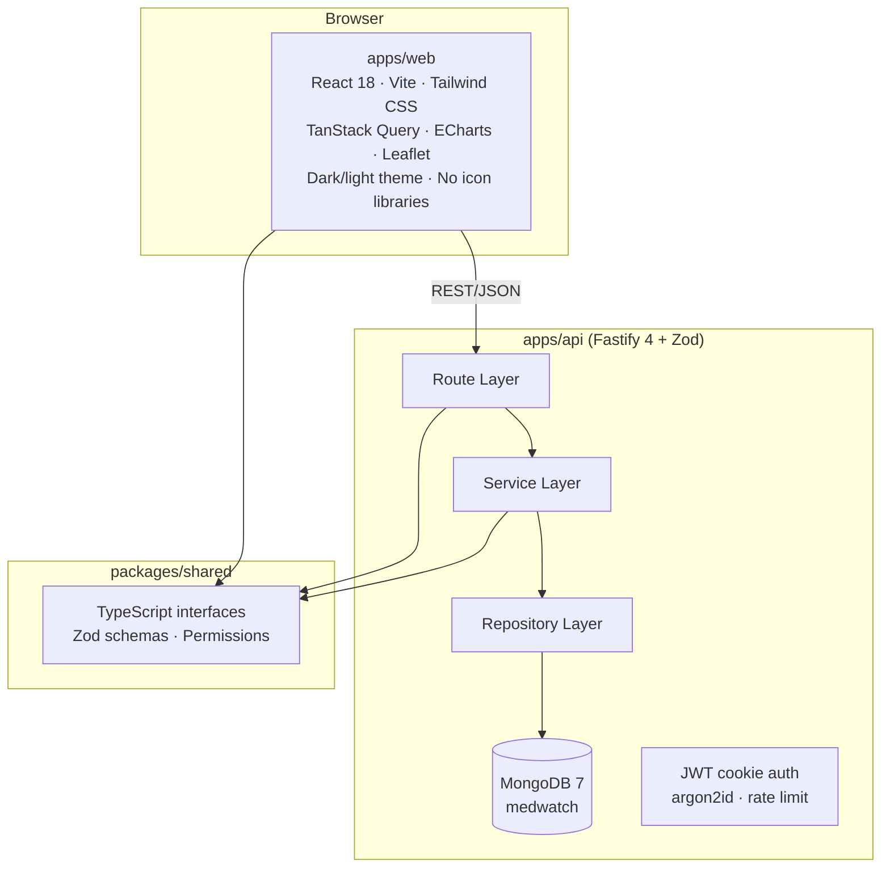

# MedWatch — Medicine Stock-Out Tracking System

A MongoDB-backed system for tracking medicine stock-outs, low stock, and near-expiry batches
across public health facilities in Uganda.

Built for the **NoSQL Databases Mid-Semester Task** (13 October 2026).

---

## Architecture



---

## Quick Start

```bash
# 1. Start MongoDB
docker compose up -d

# 2. Install dependencies (pnpm required)
pnpm install

# 3. Configure environment
cp .env.example .env
# Edit .env — set JWT_SECRET to a long random string

# 4. Seed the database
pnpm seed

# 5. Start API + web in parallel
pnpm dev
```

- **API:** http://localhost:3001
- **Swagger UI:** http://localhost:3001/docs
- **Web UI:** http://localhost:5173

### Optional: larger demo dataset

```bash
pnpm seed:demo   # ~40 facilities, 12 months, realistic seasonality
```

### Verify data integrity

```bash
pnpm verify-data   # checks closing = opening + received - issued for every stock record
```

---

## PDF Query → API Endpoint → UI Screen

| PDF §7 | Description | API endpoint | UI screen |
|--------|-------------|-------------|-----------|
| Q7.1 | Unresolved stock-outs | `GET /analytics/stockouts` | Alerts page (type = stockout) |
| Q7.2 | Stock-out days by district | `GET /analytics/stockout-days-by-district` | Dashboard — stacked district chart |
| Q7.3 | Batches expiring in 90 days | `GET /analytics/expiring-batches?days=90&asOf=` | Expiry Tracker page |
| Q7.4 | Resolve an alert | `PATCH /alerts/:id/resolve` | Alerts page — Resolve button |
| Q7.5 | Stock below reorder level | `GET /analytics/below-reorder` | Stock Records page / Dashboard KPI |
| Q7.6 | Escalate old pending requests | `POST /stock-requests/escalate-pending?before=` | Requests page — Escalate action |
| GeoNear | Nearest facility with stock | `GET /facilities/nearest?medicineId=&lng=&lat=&minQty=` | Facility Map — Find nearest panel |

Raw mongosh versions of all queries: `docs/mongosh/q7.1.js` through `docs/mongosh/q7.6.js`

---

## Known Issues in the PDF

| # | Issue | Resolution |
|---|-------|-----------|
| PDF-1 | Batch AM-2311 (HF001/MED001) has no near-expiry alert in the PDF seed. | AL007 inserted by seed script. Integration tests assert its presence. |
| PDF-2 | Q7.4 resolves AL002 but SQ002 (same facility) stays pending — ambiguous cascade. | No cascade. Alert and request resolution are independent (documented in alert service). |
| PDF-3 | SR001 has `stockout_days: 9` with `closing: 20`. | `stockout_days` is an observed field. Verify script does not flag SR001. |
| PDF-4 | Q7.6 sets `escalated: true`; project brief says change `status`. | API uses `status: "approved"`. The mongosh script preserves the PDF's `escalated: true`. |
| PDF-5 | Brief says 32 docs with 5+7+10+5+5; PDF breakdown is 6+6+8+6+6. | PDF breakdown used: 6/6/8/6/6 = 32. Plus AL007 = 33 after seed. |
| PDF-6 | PDF recommends ObjectIds in production. | Covered in `docs/migration/objectid-migration.md`. |

---

## Test Results

```
API (Vitest + mongodb-memory-server)
  stockRecord.test.ts  5 tests  PASS
  alerts.test.ts       3 tests  PASS
  analytics.test.ts    4 tests  PASS  ← asserts Q7.2 / Q7.3 / Q7.5 / Q7.6 exact outputs
  auth.test.ts         5 tests  PASS

Web (Vitest)
  no-emoji.test.ts    28 tests  PASS  ← scans 28 source files for Unicode emoji
  insights.test.ts     7 tests  PASS  ← pure generateInsights() function

Total: 52 tests, 0 failures
```

---

## Tech Stack

| Layer | Technology |
|-------|-----------|
| Language | TypeScript 5 strict, Node.js 20+ |
| Package manager | pnpm 9 workspaces |
| Database | MongoDB 7 (official driver — no Mongoose) |
| API | Fastify 4, fastify-type-provider-zod, @fastify/jwt, argon2 |
| Frontend | React 18, Vite, React Router 6, TanStack Query v5 |
| Charts | Apache ECharts via echarts-for-react (Recharts removed) |
| Maps | Leaflet + react-leaflet (CSS CircleMarker — no icon libraries) |
| Styling | Tailwind CSS v3 + CSS custom property design tokens |
| Font | Inter Variable via @fontsource/inter (self-hosted) |
| Testing | Vitest + mongodb-memory-server |
| CI | GitHub Actions |

---

## Design System Summary

- **Dark theme by default**, light derived. Toggle in user menu. Stored in `localStorage['mw-theme']`.
- **No icon libraries.** ESLint rule blocks all icon imports. Navigation and buttons are text-only.
- **No emoji in source files.** Enforced by `no-emoji.test.ts` which fails the build on any Unicode emoji.
- **CSS custom properties only.** All colours, spacing, radii, shadows defined in `apps/web/src/styles/tokens.css`. No hard-coded hex values in components.
- **Status communicated by text badges** ("Critical", "Healthy") never by colour or icon alone.

---

## Project Structure

```
medwatch/
├── apps/
│   ├── api/                   Fastify API
│   │   ├── src/
│   │   │   ├── db/            MongoDB client, collections, indexes
│   │   │   ├── routes/        One Fastify plugin per resource
│   │   │   ├── services/      Business rules (alert, stockRecord, auth, insights)
│   │   │   └── repositories/  MongoDB aggregation pipelines
│   │   └── scripts/
│   │       ├── seed.ts        PDF data + AL007 fix (pnpm seed)
│   │       ├── seed-demo.ts   12-month demo dataset (pnpm seed:demo)
│   │       └── verify-data.ts balance invariant checker (pnpm verify-data)
│   └── web/                   React/Vite frontend
│       └── src/
│           ├── styles/        tokens.css (CSS custom properties)
│           ├── charts/        ECharts theme (dark + light)
│           ├── components/    Layout, KpiCard, CommandPalette, ConfirmDialog
│           ├── context/       ThemeContext, AuthContext
│           ├── hooks/         TanStack Query hooks + pure insights function
│           ├── pages/         Dashboard, Alerts, StockRecords, Expiry, Map, Requests, Users
│           └── test/          no-emoji.test.ts, insights.test.ts
├── packages/
│   └── shared/                TypeScript interfaces, Zod schemas, permissions
├── docs/
│   ├── mongosh/               q7.1.js – q7.6.js (verbatim PDF queries)
│   └── migration/             ObjectId migration guide
├── .kiro/specs/medwatch/      requirements.md, design.md, design-system.md, tasks.md
├── docker-compose.yml
├── .env.example
└── .github/workflows/ci.yml   lint → typecheck → test
```
